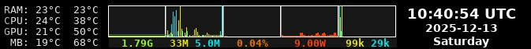

<!--
SPDX-FileCopyrightText: Robert Ryszard Paciorek <rrp@opcode.eu.org>
SPDX-License-Identifier: MIT
-->

# Interactive Conky Panel

This repository contains configuration and lua scripts for Conky Panel, placed in the bottom right corner of the screen (to act as an extension of lxpanel).

The panel includes:

* temperature monitoring
* memory graph
* disk read/write graph
* CPU load graph
* GPU power consumption graph
* network download/upload graph
* clock

The panel has mouse support for:

* switching time zones using the scroll wheel
* opening a calendar window (via [yad](https://sourceforge.net/projects/yad-dialog/)) by clicking the clock
* tooltips for each element
* resize the window by clicking (the contents of the bigger window are still WIP/TODO)

To provide higher resolution for some data (e.g., fractional CPU load and low network speed values), scripts read data directly through `/proc` and `/sys`.
This causes incompatibility with non-Linux systems, but this behavior can be changed by editing the data collection functions contained in the `*_read.lua` files.

The data available from hwmon is configured via `hwmon_config.sh`, which is executed at panel startup.
Its design allows it to be independent of changes in the `hwmon` directory numbering, but due to its nature it remains hardware dependent.

## License

* Project use per file [REUSE](https://reuse.software/)/SPDX type copyright info.
* Main licence for this project is [MIT](LICENSE)
